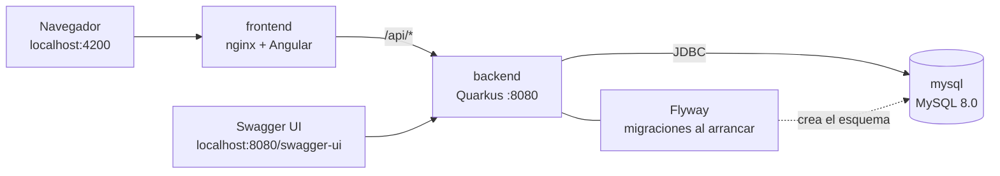
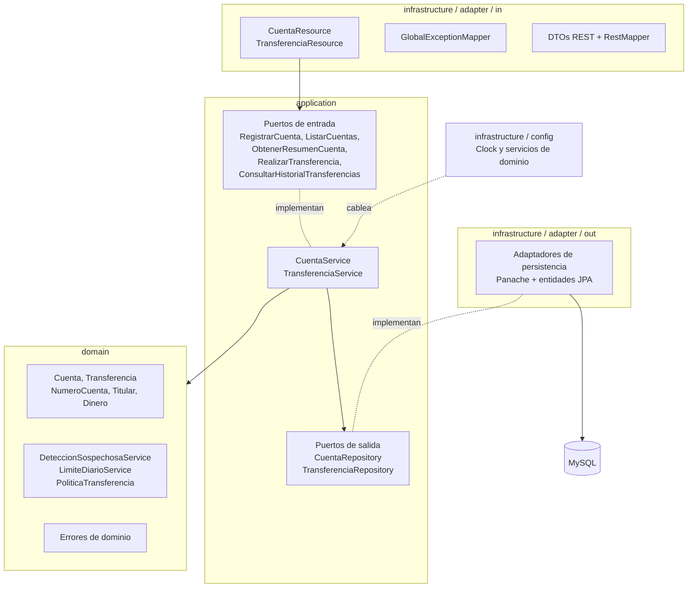
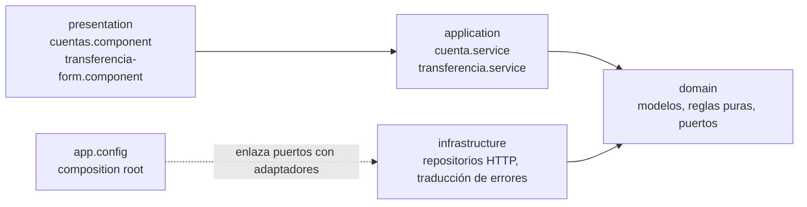
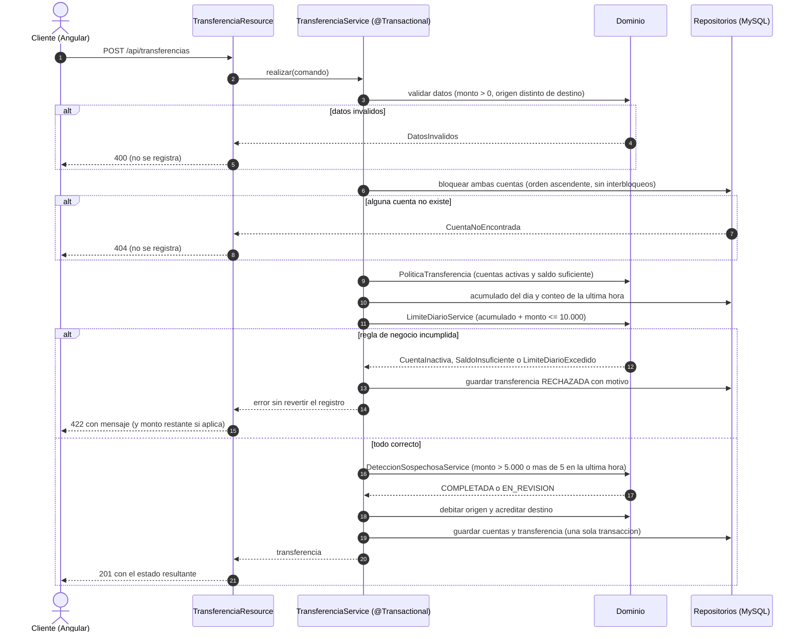
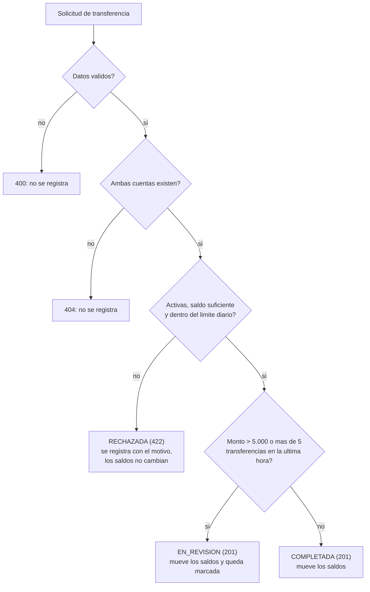

# EvaluacionEdwinZamora

Sistema de Gestión de Transferencias Interbancarias — Reto técnico Full Stack (Java Quarkus / Angular / MySQL).
Autor: **Edwin Zamora**.

| Módulo | Carpeta | Tecnología |
|---|---|---|
| EvaluacionEdwinZamora-backend | [`EvaluacionEdwinZamora-backend/`](EvaluacionEdwinZamora-backend) | Java 21, Quarkus 3.39 (Quarkus REST, Hibernate ORM Panache), MapStruct, Flyway, OpenAPI |
| EvaluacionEdwinZamora-frontend | [`EvaluacionEdwinZamora-frontend/`](EvaluacionEdwinZamora-frontend) | Angular 21, Angular Material, Vitest |
| EvaluacionEdwinZamora-database | [`EvaluacionEdwinZamora-database/`](EvaluacionEdwinZamora-database) | MySQL 8.0 con su propio Dockerfile (el esquema lo crea Flyway) |
| Infraestructura | [`docker-compose.yml`](docker-compose.yml) | Docker Compose: construye y levanta las tres imágenes (mysql, backend, frontend/nginx), cada una con su Dockerfile |

## 1. Arranque rápido (Docker, un solo comando)

Requisitos: Docker y Docker Compose.

```bash
docker compose up --build
```

| Servicio | URL |
|---|---|
| Frontend (dashboard) | http://localhost:4200 |
| API REST | http://localhost:8080/api |
| **Swagger UI** | **http://localhost:8080/swagger-ui** |
| OpenAPI (en vivo) | http://localhost:8080/q/openapi |
| **Contrato OpenAPI (YAML versionado)** | [`EvaluacionEdwinZamora-backend/src/main/resources/openapi.yaml`](EvaluacionEdwinZamora-backend/src/main/resources/openapi.yaml) |
| Health | http://localhost:8080/q/health |
| MySQL (solo loopback del host) | `127.0.0.1:3307` |

El frontend llama a `/api/...` y nginx lo reenvía al backend, por lo que no hay problemas de CORS dentro de Docker.
Para personalizar puertos, credenciales o zona horaria: copia `.env.example` a `.env` y ajústalo.

**Datos de demostración:** con Docker Compose el backend carga 3 cuentas (`1710000001` Ana Pérez, `1710000002` Luis Mora y `1710000003` María Torres, esta inactiva) y 4 transferencias de ejemplo (completadas, en revisión y rechazada), para que el dashboard no aparezca vacío. Se incluyen al construir la imagen mediante el argumento `FLYWAY_LOCATIONS` (ver `docker-compose.yml`); un build normal (`./mvnw package`) o las pruebas arrancan con la base vacía.

Para detener y borrar datos: `docker compose down -v`.

## 2. Base de datos

- Motor: **MySQL 8.0**. El esquema se crea automáticamente al arrancar el backend con **Flyway**:
  [`EvaluacionEdwinZamora-backend/src/main/resources/db/migration/V1__create_cuentas_transferencias.sql`](EvaluacionEdwinZamora-backend/src/main/resources/db/migration/V1__create_cuentas_transferencias.sql)
  (tablas `cuentas` y `transferencias`, índice único del número de cuenta, `CHECK` de saldo ≥ 0 y de monto > 0).
- Con Docker Compose no hace falta configurar nada. Para usar un MySQL propio, crea la base y el usuario y define:

| Variable | Por defecto | Descripción |
|---|---|---|
| `DB_URL` | `jdbc:mysql://localhost:3307/transferencias?...` | URL JDBC |
| `DB_USERNAME` / `DB_PASSWORD` | `transferencias` / `transferencias` | Credenciales |
| `APP_TIMEZONE` | `America/Guayaquil` | Zona que define el «día calendario» y la «última hora» |
| `CORS_ORIGINS` | `http://localhost:4200` | Orígenes permitidos |
| `DB_LOCK_WAIT_SECONDS` | `5` | Espera máxima por bloqueo de fila |

## 3. Backend: compilar, probar y ejecutar

Requisitos: JDK 17+ (se usa 21). El wrapper `./mvnw` descarga Maven 3.9.

```bash
cd EvaluacionEdwinZamora-backend
./mvnw -B verify            # compila y ejecuta unitarias + integración (ver nota)
./mvnw -B package -DskipTests
./mvnw quarkus:dev          # modo desarrollo (necesita MySQL en DB_URL, p. ej. `docker compose up mysql`)
```

> Los tests de integración usan **Quarkus Dev Services**: levantan un MySQL 8.0 efímero con Docker, por lo que Docker debe estar en ejecución. Alternativa: apuntar `QUARKUS_DATASOURCE_JDBC_URL` a un MySQL propio.

## 4. Frontend: instalar, probar y ejecutar

Requisitos: Node 22.12+.

```bash
cd EvaluacionEdwinZamora-frontend
npm ci
npm start                       # http://localhost:4200 (proxy /api -> http://localhost:8080)
npm test -- --watch=false       # pruebas unitarias
npm run lint:arch               # reglas de arquitectura (capas)
npm run build
```

## 5. API

El contrato completo (endpoints, parámetros, códigos de respuesta, esquemas y ejemplos) está en [`openapi.yaml`](EvaluacionEdwinZamora-backend/src/main/resources/openapi.yaml). Se regenera automáticamente en cada `./mvnw package` a partir de las anotaciones del código, por lo que no se desfasa del servicio.

| Método | Ruta | Descripción | Códigos |
|---|---|---|---|
| POST | `/api/cuentas` | Registra una cuenta | 201, 400, 409 |
| GET | `/api/cuentas?page&size` | Lista paginada de cuentas (size 1..200) | 200, 400 |
| GET | `/api/cuentas/{id}/resumen` | Saldo, total transferido hoy, nº de transferencias del día y sospechosas | 200, 404 |
| POST | `/api/transferencias` | Ejecuta una transferencia (`cuentaOrigen`, `cuentaDestino` = número de cuenta, `monto`) | 201, 400, 404, 422 |
| GET | `/api/transferencias?origen&destino&desde&hasta&estado&page&size` | Historial, orden por fecha descendente (`desde`/`hasta` en ISO-8601) | 200, 400 |

Formato de error único (`GlobalExceptionMapper`):

```json
{ "timestamp": "...", "status": 422, "code": "LIMITE_DIARIO_EXCEDIDO",
  "message": "Límite diario excedido. Monto restante disponible: 500.00",
  "path": "/api/transferencias", "details": [] }
```

Ejemplo:

```bash
curl -X POST http://localhost:8080/api/cuentas -H 'Content-Type: application/json' \
  -d '{"numero":"1000000001","titular":"Ana Pérez","tipo":"AHORRO","saldoInicial":20000.00,"estado":"ACTIVA"}'
curl -X POST http://localhost:8080/api/transferencias -H 'Content-Type: application/json' \
  -d '{"cuentaOrigen":"1000000001","cuentaDestino":"1000000002","monto":100.00}'
```

## 6. Reglas de negocio y decisiones

| Regla | Dónde vive |
|---|---|
| RN-1 Cuenta: número único de 10 dígitos, titular, tipo, saldo ≥ 0, estado | Dominio: `NumeroCuenta`, `Titular`, `Dinero`, `Cuenta` |
| RN-2 Transferencia válida: cuentas existentes y activas, saldo suficiente, monto > 0 | Dominio: `PoliticaTransferencia`, `Cuenta`, `Transferencia` |
| RN-3 Sospechosa: monto > 5.000 o > 5 transferencias del origen en la última hora | Dominio: `DeteccionSospechosaService` |
| RN-4 Límite diario 10.000 por cuenta origen y día calendario, informa el monto restante | Dominio: `LimiteDiarioService` |
| RN-5 Atomicidad: ambos saldos en una sola transacción | `TransferenciaService` con `@Transactional` + bloqueo pesimista ordenado |

Decisiones de interpretación:

- Una transferencia **EN_REVISION** (sospechosa) **sí mueve los saldos** y queda marcada para revisión; cuenta para el límite diario y para el conteo de la última hora.
- Los rechazos por regla de negocio (cuenta inactiva, saldo insuficiente, límite excedido → HTTP 422) **se registran** como transferencia `RECHAZADA` con su motivo, sin tocar saldos. Los errores 400 y 404 no se registran.
- Límite diario: suma de transferencias `COMPLETADA` + `EN_REVISION` del origen en el día calendario de `APP_TIMEZONE`; se rechaza si `acumulado + monto > 10000` (exactamente 10.000 se permite). Las `RECHAZADA` no cuentan.
- Sospechosa por frecuencia: la **sexta** transferencia dentro de la última hora ya es sospechosa (monto exactamente 5.000 no lo es).
- Los montos usan `BigDecimal` con 2 decimales; más de 2 decimales se rechaza (400).
- Para evitar interbloqueos, las dos cuentas se bloquean siempre en orden ascendente por número.

## 7. Arquitectura

**Backend — hexagonal (puertos y adaptadores) con DDD.** Paquetes bajo `com.netby.transferencias`:

```
domain/          Cuenta, Transferencia, VOs (NumeroCuenta, Titular, Dinero), servicios de dominio, errores
application/     puertos de entrada (casos de uso) y salida (repositorios), CuentaService, TransferenciaService
infrastructure/
  adapter/in/    REST: Resources, DTOs, mapper, GlobalExceptionMapper
  adapter/out/   Persistencia: entidades JPA, Panache, adaptadores
  config/        Cableado de dependencias (Clock y servicios de dominio)
```

El dominio es Java puro (sin frameworks); lo verifican reglas **ArchUnit** que forman parte de la suite de tests.

**Frontend — arquitectura limpia** en `EvaluacionEdwinZamora-frontend/src/app/`: `domain` (modelos, reglas puras, puertos) → `application` (casos de uso) → `infrastructure` (HTTP) → `presentation` (componentes). Las dependencias se verifican con `npm run lint:arch`.

### 7.1 Arquitectura del proyecto

**Despliegue (Docker Compose):** tres imágenes, cada una con su Dockerfile.



**Backend — hexagonal.** Las dependencias apuntan siempre hacia el dominio.



**Frontend — arquitectura limpia (Angular).**



### 7.2 Arquitectura de comportamiento

**Secuencia de `POST /api/transferencias`** (RN-2, RN-3, RN-4 y RN-5).



**Decisión del estado de una transferencia.**



### Criterio del reto → archivo

| Criterio | Archivo(s) |
|---|---|
| CA-01 Cuentas | `infrastructure/adapter/in/rest/CuentaResource.java`, `infrastructure/adapter/out/persistence/entity/CuentaEntity.java` (entidad JPA), `domain/cuenta/Cuenta.java` (dominio), `application/out/CuentaRepository.java` |
| CA-02 Transferencias | `infrastructure/adapter/in/rest/TransferenciaResource.java`, `application/service/TransferenciaService.java`, `domain/transferencia/Transferencia.java` |
| CA-03 Sospechosas | `domain/transferencia/DeteccionSospechosaService.java` |
| CA-04 Límite diario | `domain/transferencia/LimiteDiarioService.java` |
| CA-05 Historial y resumen | `TransferenciaResource` (`GET /api/transferencias`), `CuentaResource` (`GET /api/cuentas/{id}/resumen`) |
| CA-06 Dashboard de cuentas | `EvaluacionEdwinZamora-frontend/src/app/presentation/cuentas/cuentas.component.{ts,html}`, `application/cuenta.service.ts` |
| CA-07 Formulario | `EvaluacionEdwinZamora-frontend/src/app/presentation/transferencia-form/transferencia-form.component.{ts,html}`, `application/transferencia.service.ts` |
| CA-08/09 Capas y calidad | estructura hexagonal/clean, DTOs, `GlobalExceptionMapper`, `@Inject`, MapStruct |
| CA-10 Documentación | este README + Swagger UI |
| Extras | Docker Compose, tests unitarios (JUnit 5 + Mockito), integración (`@QuarkusTest`), paginación, MapStruct, logs JBoss, CORS |

## 8. Pruebas

- Backend: dominio puro, servicios con dobles en memoria, adaptadores contra MySQL real, REST con RestAssured, atomicidad/rollback, concurrencia (transferencias opuestas sin interbloqueo, límite diario con hilos) y reglas ArchUnit.
- Frontend: reglas de dominio, casos de uso con fakes, repositorios HTTP con `HttpTestingController` y componentes.

## 9. Limitaciones conocidas

- La API **no implementa autenticación ni autorización** (no es requisito del reto); en un entorno real habría que añadir OIDC/JWT y propiedad de cuentas.
- La tabla de cuentas se ordena en el cliente sobre las primeras 200 cuentas cargadas.
- No hay idempotencia en `POST /api/transferencias`.
